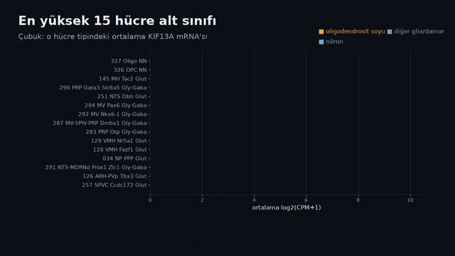
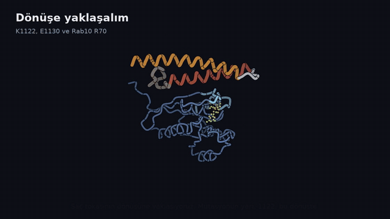
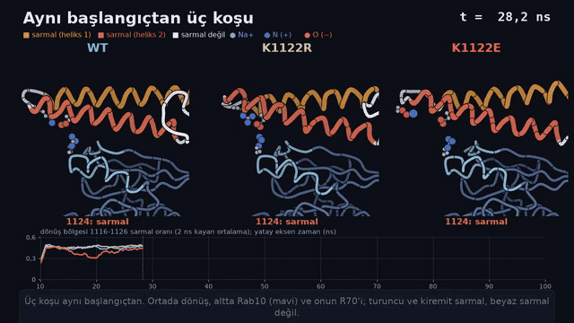
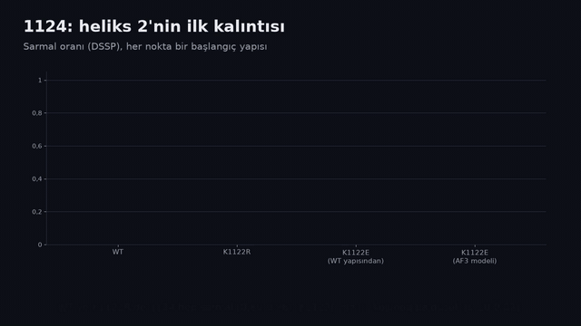

# KIF13A NeuroVariant Atlas

KIF13A geni üzerine yapılan bütün hesaplamalı analizlerin deposu. Üç soru soruluyor:

1. **KIF13A nerede ifade ediliyor?** Fare ve insan beyninin tek hücre atlasları, omurilik, doku düzeyi veriler ve genetik ilişkilendirme verileri.
2. **KIF13A'daki hangi varyantlar zararlı olabilir?** Kardeş gen KIF1A'nın klinik bilgisiyle kalibre edilmiş varyant önceliklendirmesi ve hastalık öncülünün eksen eksen sınanması.
3. **ClinVar'daki K1122E varyantı proteinde neyi değiştiriyor?** Yapı tahmini, kuantum kimyası, klasik serbest enerji hesapları ve 100 ns'lik moleküler dinamik (MD) koşuları.

Bütün ağır hesaplar TÜBİTAK ULAKBİM TRUBA'da (SLURM) ve yerel bir GPU iş istasyonunda (2x RTX 3090) yapıldı. Protein numaraları MANE Select numaralandırmasıdır.

**Durum (9 Ekim 2026):**

| İş | Durum |
|---|---|
| İfade analizleri (Kısım 1) | bitti |
| Varyant önceliklendirme ve kanıt eksenleri (Kısım 2A) | bitti |
| K1122E yapı, kuantum ve PMF kolları (Kısım 2B-2D) | bitti |
| Kompleks MD: Rab10 + KIF13A, 12 koşu x 100 ns (Kısım 2E) | bitti, analiz edildi |
| Monomer MD: KIF13A saç tokası, 30 görev (Kısım 2F) | 8'i bitti; K1104E ve E1128K kontrolleri sürüyor |
| SO3LR (makine öğrenmeli kuvvet alanı) PMF kolu | sürüyor |

## İçindekiler

- [Videolar](#videolar)
- [Kısa sonuç](#kısa-sonuç)
- [Arka plan](#arka-plan)
- [Kısım 1: KIF13A nerede ifade ediliyor?](#kısım-1-kif13a-nerede-ifade-ediliyor)
- [Kısım 2A: Varyant analizi](#kısım-2a-varyant-analizi)
- [Kısım 2B: K1122E varyantının profili](#kısım-2b-k1122e-varyantının-profili)
- [Kısım 2C: Yapı](#kısım-2c-yapı)
- [Kısım 2D: Fizik kolları](#kısım-2d-fizik-kolları-yöntemlerin-kendisi-sınandı)
- [Kısım 2E: Kompleks MD](#kısım-2e-kompleks-md-rab10--kif13a)
- [Kısım 2F: Monomer MD](#kısım-2f-monomer-md-rab10-olmadan)
- [Bütünsel okuma](#bütünsel-okuma)
- [Açık işler](#açık-işler)
- [Yeniden üretim](#yeniden-üretim)
- [Sözlük](#sözlük)
- [Klasörler](#klasörler)
- [Referans kimlikler](#referans-kimlikler)
- [Kaynaklar](#kaynaklar)

---

## Videolar

Dört kısa video, analizlerin ana çizgisini görsel olarak anlatıyor. Aşağıdaki hareketli önizlemeler videoların bir bölümü; tam sürüm (MP4, altyazılı, 1280x720) bağlantıdadır. Videoları üreten kod `scripts/k1122e_video/` içinde.

### 1. KIF13A beyinde nerede? ([MP4, 65 sn](figures/videos/01_ifade.mp4))

Allen Brain Cell Atlas'ta 265 hücre alt sınıfının sıralaması, "16 kat" hatasının neden yanlış olduğu (yakalanma oranı ile düzeyin ayrılması), motor nöron kontrolü ve yaşlanma: farede artış, insanda yok.



### 2. K1122E nerede duruyor? ([MP4, 49 sn](figures/videos/02_yapi.mp4))

Rab10-KIF13A modelinde mutasyonun yeri: K1122, E1130'u tutuyor; E1130 da Rab10 R70 ile tuz köprüsü kuruyor. K1122E bu tutamağı kaldırıyor. Asıl ara yüz 15-36 Å uzakta.



### 3. MD: aynı başlangıç, üç dizi ([MP4, 44 sn](figures/videos/03_md.mp4))

Aynı başlangıç yapısından koşulan WT, K1122R ve K1122E, 100 ns. Turuncu ve kiremit renk sarmal, beyaz sarmal değil. K1122E'de yaklaşık 50 ns'den sonra heliks 2'nin ilk dönüşü çözülüyor; WT ve K1122R'de dönüş sabit. Alttaki eğri dönüş bölgesinin sarmal oranı.



### 4. Bütün koşular: ne değişti, ne değişmedi? ([MP4, 77 sn](figures/videos/04_sonuclar.mp4))

12 başlangıç yapısında 1124'ün tam ayrışması, Rab10 olmadan aynı etki, zaman içinde dönüş, değişmeyen ara yüz, heliks 1 tarafındaki temkinli hipotez ve GBSA'nın tutarsızlığı.



---

## Kısa sonuç

| Soru | Cevap | Güven |
|---|---|---|
| KIF13A beyinde en çok nerede? | Oligodendrosit soyunda: farede olgun oligodendrosit 1., insanda OPC 1. | yüksek |
| "Oligodendrosite özgü" mü? | Kanıtlanmadı; fark yakalanmada yaklaşık 1,8, düzeyde yaklaşık 2 kat | |
| Nöronlarda nerede? | Genelde düşük; medial habenula kolinerjik nöronları istisna (bütün beyinde 3.) | orta |
| Motor nöronlarda yüksek mi? | Hayır; aynı hücreler Kif5a ve Kif1a'yı bol taşıyor | yüksek (negatif) |
| Yaşla artıyor mu? | Farede olgun oligodendrositte %19; insanda hayır (güç >0,99) | yüksek (insanda negatif) |
| Beyaz madde GWAS sinyali oligodendrosit KIF13A'sı üzerinden mi? | Hayır; eQTL ve GWAS farklı varyantlardan | karşı kanıt |
| KIF13A bir hastalık geni mi? | Kanıt yok; her hastalık hipotezi ayrı test edildi, hiçbiri kurtarılamadı | |
| K1122E proteinde neyi değiştiriyor? | Saç tokasının dönüşünü ve heliks 2'nin başını (1124-1125) yerel olarak çözüyor | yüksek (MD içinde) |
| K1122E Rab10 bağlanmasını bozuyor mu? | 100 ns MD'de ara yüz kırılmıyor | orta |
| Etki her yük tersine çevirmesinde görülür mü? | Hayır; aynı heliksteki K1104E hiçbir şeyi değiştirmiyor, etki konuma özgü | yüksek (MD içinde) |
| K1122E Rab10'un GTP hidroliz geometrisini (Q68) değiştiriyor mu? | Hayır; Q68 ve gama-fosfat suyu 12 koşuda ayrışmıyor | orta (negatif) |
| K1122E patojenik mi? | Bilinmiyor; kalıtım bilgisi yok ve hesaplar tek başına bunu söyleyemez | |

---

## Arka plan

**KIF13A**, kinezin-3 ailesinden bir motor proteindir (1805 aminoasit). Mikrotübüller üzerinde hücre zarına bağlı kargoları (özellikle geri dönüşüm endozomlarını) taşır ve kargosunu Rab GTPazları ile seçer. Kuyruğundaki 1102-1146 bölgesi Rab10'a bağlanır (Etoh ve Fukuda 2019).

**Neden KIF1A?** Aynı ailedeki KIF1A, KAND adı verilen nörolojik hastalığa yol açar ve ClinVar'da yüzlerce sınıflandırılmış varyantı vardır. KIF13A'da ise hiç yoktur. Proje, KIF1A'da öğrenilenleri KIF13A'ya taşımayı ve bunun ne kadar işe yaradığını ölçmeyi hedefledi.

**K1122E nedir?** KIF13A'nın 1122. konumundaki lizinin (artı yüklü) glutamata (eksi yüklü) dönüştüğü tek harflik bir değişim (c.3364A>G). ClinVar'da HudsonAlpha'nın kaydı (VCV002570672), "anlamı belirsiz varyant" (VUS). KIF13A'da gerçek bir fenotiple bildirilmiş tek missense kayıt bu. Varyant, Rab10 bağlama bölgesindeki bir saç tokasının (iki sarmal ve aradaki dönüş) dönüşünde duruyor.

```
heliks 1 (1088-1117)  ->  dönüş (1118-1123, K1122 burada)  ->  heliks 2 (1124-1148, Rab10'a değen heliks)
```

---

## Kısım 1: KIF13A nerede ifade ediliyor?

Kod ve tablolar: [ikoshos-gland/kif13a-allenbrain](https://github.com/ikoshos-gland/kif13a-allenbrain) (fare atlası, omurilik, habenula, kinezin korelasyonları) ve bu depodaki `docs/insan_yasam_boyu.md`, `docs/eqtl_hucre_tipi.md`, `docs/ak_madde_goruntuleme.md`.

### 1.1 Kullanılan veri setleri

| Veri seti | İçerik | Ne için |
|---|---|---|
| Allen ABC WMB-10Xv3 (sürüm 20260711) | 2.341.350 hücre, 13 bölge, 265 yeterli örneklenmiş alt sınıf | fare beyni hücre tipi sıralaması |
| Zeng Aging Mouse 10Xv3 | 1.162.565 hücre, 108 fare | fare yaşlanması |
| CELLxGENE omurilik (Alkaslasi 2021, Russ 2021) | kolinerjik ve harmonize omurilik atlasları | motor nöron sorusu |
| CELLxGENE insan beyni | hücre tipi atlasları | insanda hücre tipi |
| İnsan yaşam boyu: Nature 2026 PsychAD yaşlanma kohortu (291 donör, 1,33 milyon çekirdek), SEA-AD, beyaz madde seti, iki gelişim seti | 335 donörlük meta analiz | insanda yaşlanma ve gelişim |
| Hücre tipi eQTL: Zeng 2026 (1.384 donör), SingleBrain 2025, Bryois 2022 | tek çekirdek eQTL | GWAS ile kolokalizasyon |
| UK Biobank BIG40, UDIP-FA GWAS | beyaz madde görüntüleme | KIF13A bölgesinde sinyal |
| GTEx v10, HPA | doku ve tek hücre ifadesi, antikor boyaması | vücut geneli |

Tek hücre verisindeki birim **log2(CPM+1)**: bir hücredeki okumaların milyonda kaçının bu genden geldiğinin logaritması. Bu bir mRNA ölçüsüdür, protein değil.

### 1.2 Fare beyni: hücre tipi sıralaması

| Hücre tipi (sıra) | Ortalama log2(CPM+1) | Geni ifade eden hücre oranı | İfade eden hücrede düzey (CPM) |
|---|---|---|---|
| Olgun oligodendrosit (1.) | 7,77 | 0,93 | 335 |
| OPC, oligodendrosit öncülü (2.) | 6,76 | 0,85 | 246 |
| Medial habenula kolinerjik, 145 MH Tac2 Glut (3.) | 6,76 | 0,92 | |
| Medulla glisinerjik, 298 PRP Gata3 (4.) | 6,68 | 0,94 | |
| NTS Dbh nöronları (5.) | 6,04 | 0,88 | |
| Mikroglia (168.) | 3,88 | 0,49 | 236 |
| Astrosit, telensefalik (178.) | 3,77 | 0,51 | 168 |
| Perisit (240.) | 2,85 | 0,35 | 273 |

**"Astrositten 16 kat yüksek" ifadesi yanlıştı.** Ortalama log2 değeri iki şeyi tek sayıda birleştiriyor: genin kaç hücrede yakalandığını ve yakalandığı hücrede ne kadar olduğunu. İki ortalamanın farkını 2'nin üssü yapmak (2 üzeri 4 = 16) kat değişimi vermez. Bileşenlere ayrılınca oligodendrosit, astrositin yakalanmada yaklaşık 1,8 katı, yakalandığı hücrede düzeyde yaklaşık 2 katı çıkıyor (`analysis/detection_vs_level.py`, kif13a-allenbrain).

**Perisit bu tuzağı somutlaştırıyor:** sıralamada 240., ama geni ifade eden perisitlerde düzey astrositten yüksek. 10x verisinde yakalanma oranı hücrenin taşıdığı RNA miktarına bağlıdır ve bu analiz bunu düzeltmiyor. Sonuç: oligodendrositlerin en üstte olduğu kesin, "oligodendrosite özgü" demek kanıtlanmadı.

### 1.3 Bölgesel fark

OPC'deki KIF13A bölgeden bölgeye değişiyor: korteks ve hipokampusta yüksek, serebellum ve medullada düşük. Olgun oligodendrositte beyin boyunca düz. Varyans farkı anlamlı (Levene p<0,0001) ve sıralama bağımsız yaşlanma kohortunda tekrarlanıyor (ortak 7 bölgede Spearman rho=+0,96).

### 1.4 Nöronlar

**Medial habenula, glia dışındaki en güçlü sinyal.**
- `145 MH Tac2 Glut` (kolinerjik) bütün beyinde 3. sırada.
- Aynı farenin diğer nöronlarından log2 ölçeğinde 2,44 yüksek (13 donör, Bonferroni p=0,0029).
- En yüksek üç kümesi (8,11 / 8,08 / 7,97) beyin geneli oligodendrosit ortalamasını (7,77) geçiyor.
- Lateral habenula bu sinyali göstermiyor (4,82).
- Medulla glisinerjik ve GABAerjik çekirdekleri, NTS Dbh ve VMH onu izliyor; Bonferroni sonrası 9 alt sınıf ayakta kalıyor.
- Korteks bloğu bütünüyle düşük (01 IT-ET Glut, 34 sınıf içinde 30.).

**Motor nöron hipotezi negatif.**
- Allen atlasında omurilik yok; omurilik verisi CELLxGENE'den alındı ve ham sayımlardan yeniden hesaplandı.
- Omurilik motor nöronları, oligodendrositin log2 ölçeğinde 2,07 altında (8 donör, p=0,023).
- Kraniyal motor nöronlar (`252 DMX VII`), diğer medulla nöronlarının 1,33 altında (20 donör, p=1,9e-5).
- **Kilit kontrol:** aynı hücreler 84 hücre tipi arasında Kif5a'da 1., Kif1a'da 6., Kif13a'da 34. sırada. Yani "motor nöron her kinezini bol taşır" açıklaması geçersiz.
- Derinlik kontrolü ters yönde: motor nöronlar hücre başına en çok gen yakalanan grup, ama Kif13a yakalanması en düşük. Sonuç bu yüzden muhafazakâr.
- Oligodendrosit birinciliği omurilikte de tekrarlandı (başka laboratuvar, başka hazırlık).
- Birincil motor kortekste L5 ET nöronları, donör eşleştirince ya da Snap25'e göre eşleyince diğer kortikal nöronlardan ayırt edilemiyor (5 kullanılabilir donör). Disosiyasyon büyük piramidal nöronları kaybettiriyor (L5 ET/L5 IT oranı 10Xv3'te 0,013, 10Xv2'de 0,065).

### 1.5 Kargo, adaptör ve kinezin örüntüleri

- **Medial habenulada** Kif13a, talamusun 30 alt sınıfı içinde 2.; bilinen geri dönüşüm kargosu Tfrc (transferrin reseptörü) 1.
- **Kraniyal motor nöron ve L5 ET'de** KIF13A'nın adaptörleri (Rab11a, Rab10, Rab22a, Ap1m1) en üstte, Kif13a ise 27/71 ve 13/15. Adaptörler orada, motor yok.
- **Habenula içinde (20 küme)** Kif13a, Tfrc'yi izliyor (rho 0,877; yakalama derinliğiyle yalnız 0,283). Kolinerjik kimlik genleri Chat, Slc18a3 ve Slc5a7 ile 0,56-0,61. Paralog Kif13b ile 0,195.
- **265 alt sınıfta** (2.000 rastgele genlik null dağılımı, 95. persentil rho 0,491) Kif13a'nın örüntüsünü yalnız Kif15, Klc4, Kif5a ve Kif21a izliyor. Kif13b (0,470), Kif1a (0,178) ve Rab11a (0,366) rastgele aralıkta.

### 1.6 Yaşlanma: farede var, insanda yok

**Fare** (53 genç yetişkin, yaklaşık 2 aylık; 44 yaşlı, yaklaşık 18 aylık; her fare tek değer):

| Hücre tipi | Fark (log2) | Kat | Mann-Whitney p | Cliff delta |
|---|---|---|---|---|
| Olgun oligodendrosit | +0,250 | 1,19 | 0,0002 | +0,435 |
| OPC | +0,131 | 1,09 | 0,22 | +0,146 |

- İfade eden hücre oranı değişmiyor; zaten ifade eden hücreler yukarı kayıyor.
- Allen'ın kendi yaşa bağlı ifade tablosunda Kif13a yok. Etki gerçek ama mütevazı.
- Yaşlanma kohortu 13 bölgenin yalnız 7'sini kapsıyor (serebellum, medulla, talamus, olfaktör alanlar ve CTXsp yok). Habenula yaş açısından test edilemedi. Doğru ifade "yaş artışı başka yerde test edilmedi", "oligodendrosite özgü" değil.

**İnsan** (335 donör, donör başına psödobulk):
- Olgun oligodendrositte yaşlı eksi genç fark -0,057 log2 (%95 GA -0,096 ile -0,017). Farenin +0,25'lik etkisini görme gücü 0,99'un üzerindeydi (saptanabilir en küçük etki 0,085). Bu gerçek bir negatif.
- Küçük düşüş geneldeki genlerden ayırt edilemiyor (ifade düzeyi eşlenmiş genlere göre ampirik p 0,26). Doğru ifade "insanda artmıyor", "azalıyor" değil.
- OPC'de değişim yok (meta p 0,41). Pozitif kontroller çalıştı (OPC'de PDGFRA p 3e-8; 7 mikroglia yaşlanma belirtecinin 6'sı p<0,05).
- **İnsanda hücre tipi sırası** üç veri setinin üçünde de OPC 1., olgun oligodendrosit 2. (farede tersi). Astrosite göre yakalanma 1,25 kat (derinlik eşlenmiş), düzey 2,0 kat.
- **Gelişim:** OPC'deki KIF13A bebeklikten itibaren yükseliyor (üç kaynakta rho 0,43, 0,42, 0,82), değişimin yarısı 3-5 yaş civarında tamam. KIF13B ve astrositteki KIF13A da aynı biçimde yükseliyor; bu KIF13A'ya özgü değil, genel glia olgunlaşması.

### 1.7 Doku düzeyi: GTEx ve HPA

- **GTEx v10:** her dokuda var (4-41 TPM). En yüksek atardamarlar (38-41), mesane 31, rahim 27, sigmoid kolon 25, iskelet kası 24. Beyin bölgeleri 6-15 (en yüksek serebellum). EBV lenfositlerinde neredeyse yok (0,4). Paralog KIF13B tamamlayıcı: en yüksek tibial sinir (43) ve omurilik (34).
- **HPA tek hücre atlası:** en yüksek OPC (1.217 nCPM), ardından nötrofil (835), kas çekirdeği (777), oligodendrosit (614) ve koroid pleksus epiteli (572). KIF13A/KIF13B oranı OPC'de 18 ile en yüksek.
- **HPA antikor boyaması** sperm kamçısının orta ve ana parçasını gösteriyor. Bu açıklanmamış ve takip edilmedi.
- **İnsan beyni (CELLxGENE):** oligodendrosit soyu ortalama skoru 1,49, nöron tiplerinin 0,16. KIF1A bunun ayna görüntüsü: en yüksek beyin sapı motor nöronu, oligodendrosit soyunda 0,15.

### 1.8 Beyaz madde genetiği

**Görüntüleme GWAS'ı (BIG40, 33.224 kişiye kadar): zayıf destek.**
- KIF13A'nın ±100 kb'sinde beyaz madde ölçülerinde 5e-8 eşiğine ulaşan sinyal yok (en iyi p 3,5e-7).
- Ama rs76091407 (genin 5' ucundan 32,6 kb uzakta) beyaz madde mikroyapısı için genom genelinde anlamlı (UDIP-FA, p 4e-9, N 11.736).
- Bu haplotip, MetaBrain'in korteks KIF13A eQTL'iyle r²=0,969 bağlantılı.
- Etkiyi kesin göstermek için yaklaşık 46.000 kişi gerekir.

**eQTL kolokalizasyonu: oligodendrosit ve OPC için karşı kanıt.**
- KIF13A'nın oligodendrositte (öncü varyant p 2,7e-14) ve OPC'de (p 3,6e-37) güçlü eQTL'leri var, ama bunlar beyaz madde sinyalinden **farklı varyantlar**.
- Oligodendrosit ve OPC'de "iki ayrı neden" olasılığı (PP.H3) 0,78-1,00, "ortak neden" olasılığı (PP.H4) en fazla 0,015.
- Boru hattı doğrulandı: R `coloc` ile aynı sonucu veriyor ve yayımlanmış pozitif kontrolleri birebir üretiyor. Negatif sonuç yöntemin körlüğünden gelmiyor.
- Tek ipucu mikrogliada ve kırılgan: PP.H4 kullanılan LD paneline göre 0,55-0,62'den 0,002-0,03'e düşüyor.

### 1.9 Kısım 1'in güven tablosu

| Bulgu | Güven | Neden |
|---|---|---|
| Oligodendrosit soyu beyinde en üstte | yüksek | fare beyni ve omuriliği, insanda üç set, HPA |
| "Oligodendrosite özgü" | kanıtlanmadı | yakalanma oranı RNA miktarına bağlı, düzeltilmedi |
| OPC'de bölgesel değişkenlik | yüksek | iki kohortta aynı sıra |
| Medial habenula sinyali | orta | tek atlas; donör düzeyinde Bonferroni geçti; insanda bakılmadı |
| Motor nöron hipotezi | negatif | kinezin kontrolüyle |
| Farede yaşlanma artışı | orta | tek kohort, 7 bölge |
| İnsanda yaşlanma artışı | negatif | güç >0,99 |
| Beyaz madde sinyalinin oligodendrosit KIF13A'sı üzerinden etkisi | karşı kanıt | PP.H3 yüksek |

**Bütün Kısım 1 için tuzaklar:** ortalama log2 farkı kat değişimi değildir. Ölçüm mRNA'dır, protein değil. CPM göreli bir birimdir. Hücre düzeyinde test yalancı tekrar üretir; test birimi donör olmalıdır.

---

## Kısım 2A: Varyant analizi

### Yöntem: kardeş genden kalibrasyon

Varyant etkisi tahmin modelleri (AlphaMissense, ESM1b, CADD, Evo 2 ve diğerleri) KIF1A'nın motor alanında sınandı: 110 hastalık varyantına karşı 61 sağlıklı popülasyon varyantı (gnomAD, en az 3 taşıyıcı), kalıntıya göre gruplanmış bootstrap.

| Ölçülen | Sonuç |
|---|---|
| En iyi etiketsiz model | AlphaMissense, AUROC 0,925 (%95 GA 0,878-0,964) |
| Gene özgü eşik | 0,968. Genel eşik (0,564) KIF13A'da gözlenen 2.671 missense'in 982'sini zararlı sayardı, kalibre eşik 295'ini |
| Aday listesi | 295 aday: katman A 52, B 73, C 170, D 33 (`data/processed/KIF13A_candidates_20260915.tsv`) |
| Doyurma tablosu | 34.295 olası değişimin hepsi. KIF1A'da hastalık yapan değişimin aynısı olan 68 erişilebilir değişim var, 46'sı hiç insanda görülmedi |
| Yapı | AlphaFold modeli KIF1A kriyo-EM yapısına (8UTN) 1,03 Å RMSD ile oturuyor; katman A'nın %79'u işlevsel bölgede (23 ATP cebi, 18 mikrotübül yüzü) |
| Örnek dışı test | NSD1/NSD3 çiftinde yöntem tuttu (AUROC 0,973) |
| Genellenebilirlik | paralog aktarımı 3.198 gen çiftinin yaklaşık altıda birinde işliyor; KIF1A/KIF13A 152. sırada |

### Hastalık öncülü: her eksen ayrı test edildi

| Eksen | Sonuç | Belge |
|---|---|---|
| Gen düzeyi kısıtlılık (gnomAD v4.1) | missense Z 2,79 (KIF1A 6,87); gözlenen/beklenen missense 0,86 (KIF1A 0,68). KIF13A missense'e büyük ölçüde toleranslı | `skill/` ve `HANDOFF.md` |
| Bölgesel kısıtlılık | motor 0,814; ATP cebi 0,523 (KIF1A 0,140). Gerçek ama KIF1A'dan 2-4 kat sığ | `docs/bolgesel_kisitlilik.md` |
| İşlev kaybı toleransı | gözlenen/beklenen LoF 0,372; 12 yerleşik haploinsüfisiyans geninin hepsinden toleranslı (0,037-0,287). Sağlıklı insanlarda motor alanı erken kesen 29-31 varyant var | `docs/fonksiyon_kaybi_ekseni.md` |
| De novo | yaklaşık 97.700 triyoda 0 de novo LoF; 2,6 katın üzerindeki etki dışlanıyor | `docs/denovo_ekseni.md` |
| popEVE | KIF1A'da hastalık yapan 68 aynı değişimin hiçbiri KIF13A'da "ağır" değil (KIF1A'nın kendi hastalık varyantlarının %77,5'i ağır) | `docs/nakavt_ekseni.md` |
| Çift kopya nakavtları | bilgi vermiyor; yöntem KIF1A'yı bile ayıramıyor | `docs/nakavt_ekseni.md` |
| İnsan gözlemleri | 6 gözlem, hiçbiri tek başına taşımıyor; kalıtımı bilinen 4 işlev kaybı olayının 3'ü anneden, tek de novo olay mozaik | `docs/dogrulama_delesyon.md`, `docs/dogrulama_hudsonalpha.md` |

En temiz lezyon DECIPHER 451718: tamamen gen içinde kalan 146 kb delesyon, otistik davranış, kalıtım bilinmiyor. **Hâlâ ölçülmemiş tek mekanizma baskın negatif etki**, yani mutant tam boy proteinin sağlam motoru zehirlemesi.

**Bu eksenden çıkan genel ders:** bir oran, paydası ölçülmeden kanıt değildir; bir yokluk, beklenen sayısı hesaplanmadan kanıt değildir. Örneğin "HudsonAlpha'nın KIF13A'daki tek kaydı, bilinçli bir aday seçimi" yorumu, aynı gönderenin genlerinin %60,6'sında tek kayıt olduğu ölçülünce düştü.

---

## Kısım 2B: K1122E varyantının profili

| Özellik | Değer |
|---|---|
| Kayıt | c.3364A>G (chr6:17785639 T>C, GRCh38), ClinVar VCV002570672, CSER-HudsonAlpha, VUS |
| Fenotip | apraksi, nöbet, orta düzey zihinsel yetersizlik, Chiari |
| Kalıtım | bilinmiyor; etkilenme durumu da "bilinmiyor" |
| Popülasyon | gnomAD v4.1'de yok. Ayırt edici değil: KIF13A'nın olası missense'lerinin yaklaşık %82'si gnomAD'de yok |
| Korunmuşluk | 1122. konumda standart aminoasit taşıyan 191 ortolog dizinin 186'sı lizin (%97,4) |
| AlphaMissense | 0,8044. Kalibre eşiğin (0,968) altında, ama o eşik yalnız motor alan için geçerli |
| Diğer tahminler | CADD 25,2 ve PolyPhen 0,996 zararlı; REVEL 0,642, MPC 0,573; PrimateAI, FATHMM ve DEOGEN2 toleranslı |
| Splice | etki yok: SpliceAI 0,005, Pangolin 0,004 (pozitif kontroller 0,86-0,99) |
| ThermoMPNN stabilite | K1122E +1,65 kcal/mol (kararsızlaştırıcı); yükü koruyan K1122R +0,14 |
| Komşuluk | UniProt'un "coiled coil" diye işaretlediği 1100-1138'de gnomAD'de 44 missense var; aralarında aynı tür değişim K1104E (1 taşıyıcı, ThermoMPNN +0,28) ve ters yönlü E1128K (27 taşıyıcı, -0,07) |
| Chiari taban oranı | çocuk görüntülemesinde %3,6; hiçbir kinezin geni Chiari yapmıyor |

Kaydı bir basamak yukarı taşıyacak tek adım, gönderen laboratuvardan triyo (anne-baba-çocuk) verisi olup olmadığını öğrenmek. Ayrıntılar: [docs/K1122E_hesaplamalar_20261004.md](docs/K1122E_hesaplamalar_20261004.md), [docs/dogrulama_hudsonalpha.md](docs/dogrulama_hudsonalpha.md).

---

## Kısım 2C: Yapı

KIF13A'nın bu bölgesinin deneysel yapısı yok. Yapı AlphaFold 3 ile tahmin edildi (30 iş, iş başına 5 model).

- **Kontroller geçti:** AF3, Rab10:MICAL1 kristal yapısını şablonsuz da üretiyor (ara yüz geri çağırma 0,85-0,88).
- **Saç tokası:** KIF13A 1040-1200 ve 1084-1160 her modelde tek bir saç tokası; iki zincir hiçbir modelde paralel coiled coil kurmuyor.
- **Rab10 + KIF13A 1085-1160:** ara yüz güveni (ipTM) WT 0,74, K1122E 0,76; fark tohum gürültüsü içinde. Dönüşün güveni (pLDDT 1117-1124) mutantta düşüyor: 83,8'e karşı 76,7.
- **Yerleşim:** KIF13A, Rab10'a MICAL1'in yüksek afiniteli bölgesi gibi oturuyor (K1122 = MICAL1 K1022, E1130 = E1030, R1144 = R1044).
- **K1122 ara yüz kalıntısı değil, ikinci kabukta.** E1130'u molekül içinde tutuyor (2,6 Å); E1130 da Rab10'un switch II bölgesindeki R70 ile tuz köprüsü kuruyor. WT düzeni: K1122(+) / E1130(-) / R70(+), K1122 ile R70 arası yaklaşık 4,5 Å.

AF3 mutasyon etkisini tahmin etmek için eğitilmedi; iki karboksilatı 4 Å'a koyup ceza vermiyor. Bu yüzden asıl soru fizik tabanlı hesaplarla sınandı.

---

## Kısım 2D: Fizik kolları (yöntemlerin kendisi sınandı)

MD'ye güvenmeden önce, kullanılan yöntemlerin tuz köprüsünü doğru tanımlayıp tanımlamadığı ölçüldü.

**Kuantum kimyası (PBE0-D3(BJ)/def2-TZVP, PySCF).** Lys-Glu çifti, 4 ve daha fazla su varken iyon çifti olarak kalıyor; 0-2 suda proton aktarılmış nötr çift tercih ediliyor. Makine öğrenmeli kuvvet alanı SO3LR, PBE0'ı proton aktarım ekseninde 3-6 kJ/mol farkla izliyor ve hiçbir durumda tercih edilen hali değiştirmiyor.

**SO3LR suda.** 1.206 Lys-Glu ve 402 Arg-Glu karesinin hepsinde iyon çifti korunuyor; proton aktarımı olmuyor. Vakumda SO3LR tuz köprüsü için kullanılamaz.

**Klasik PMF** (iki yan zincir arasındaki uzaklığa göre serbest enerji eğrisi; şemsiye örnekleme, MBAR, 200 bootstrap):

| Çift | Kuvvet alanı | Temas serbest enerjisi (kJ/mol) | Bağlanma sabiti K_a (M⁻¹) | Deney |
|---|---|---|---|---|
| Lys-Glu | ff19SB/OPC | -4,4 | 0,32 (0,23-0,43) | yaklaşık 0,31 |
| Lys-Glu | ff19SB/OPC, 150 mM | -4,5 | 0,33 | |
| Lys-Glu | ff14SB/TIP3P | -7,3 | 0,85 (2,7 kat fazla) | |
| Arg-Glu | ff19SB/OPC | -8,5 | 0,79 (yaklaşık 2 kat fazla) | yaklaşık 0,37 |
| Arg-Glu | ff14SB/TIP3P | -12,4 | 3,45 (yaklaşık 9 kat fazla) | |
| Glu-Glu | ff19SB/OPC | +4,2 (itici) | | |
| Glu-Glu | ff19SB/OPC, 150 mM | +3,6 (itici) | | |

**Okuma:** ff19SB/OPC, Lys-Glu çiftinde deneyi tutturuyor; ana MD kolu için bu seçim veriyle destekleniyor. Arg-Glu köprüleri (R70-E1130 dahil) yine de yaklaşık 2 kat fazla dolu görünür. Glu-Glu itici: K1122E'de E1122 ile E1130 birbirini iter.

**SO3LR kolları.** Fragman MD kolunun 8 koşusunun 7'si GPU belleği yetmediği için çöktü (V100 16 GB). SO3LR PMF'lerinin üçüncü turu da 12 Ekim'de başarısız oldu; bu kollar sonuç vermeden kapandı ve hiçbir çıkarımda kullanılmadı.

---

## Kısım 2E: Kompleks MD (Rab10 + KIF13A)

### Düzen

| | Kompleks MD |
|---|---|
| Sistem | Rab10 (1-176) + GTP + Mg²⁺ + KIF13A 1085-1160 (ACE/NME kapaklı) |
| Başlangıç yapıları | AF3: WT'nin 3 tohumu (s2, s3, s5) ve K1122E'nin kendi 3 tohumu (s1, s2, s3) |
| Kollar | WT; K1122R (yük korunur); K1122E paired (WT yapısından); K1122E AF3 (AF3'ün mutant modeli) |
| Kuvvet alanı | ff19SB + OPC su; 0,15 M NaCl; 310 K; 2 fs adım; OpenMM 8.3.1 |
| Süre | koşu başına 100 ns; TRUBA'da 12, yerel GPU'da 3 koşu (aynı başlangıçların ikinci kopyaları) |
| Analiz | ilk 10 ns atılır; DSSP (sarmal), temas (en yakın ağır atomlar ≤ 0,45 nm, 100 ps arayla), tuz köprüsü (yüklü atomlar ≤ 0,40 nm, 10 ps arayla) |
| İstatistik birimi | başlangıç yapısı: aynı başlangıcın kopyalarının ortalaması. 12 birim: kontrol (WT + K1122R) 6, mutant 6. Tam Mann-Whitney; bu düzende en küçük olası iki yönlü p 0,002 |

### Sonuç tablosu

| Ölçüm (birim aralıkları) | WT | K1122R | K1122E paired | K1122E AF3 | p (6'ya 6) |
|---|---|---|---|---|---|
| 1124 sarmal oranı (DSSP) | 0,96 | 0,89-0,95 | **0,20-0,77** | **0,21-0,82** | **0,002, tam ayrışma** |
| 1125 sarmal oranı | 0,98 | 0,95-0,97 | 0,42-0,97 | 0,25-0,98 | 0,13 |
| Dönüş 1116-1126 sarmal oranı | 0,44-0,46 | 0,42-0,44 | 0,29-0,41 | 0,28-0,43 | 0,009 |
| 1117 sarmal oranı | 0,83-0,93 | 0,59-0,89 | 0,48-0,79 | 0,65-0,85 | 0,18 |
| R70-E1130 köprüsü | 0,82-0,87 | 0,67-1,00 | 0,84-0,94 | 0,89-0,92 | 0,59 |
| Ara yüz temas çifti | 28,4-35,5 | 32,6-38,3 | 30,3-38,5 | 29,5-38,4 | 0,39 |
| Gömülü yüzey (nm²) | 14,2-17,0 | 15,4-17,7 | 15,4-17,9 | 14,7-18,6 | 0,31 |
| Molekül arası tuz köprüsü sayısı | 2,70-3,08 | 2,79-3,13 | 2,43-2,87 | 1,88-2,47 | 0,009 |
| GBSA (kJ/mol, göreli) | -226 ile -199 | -246 ile -198 | -254 ile -188 | -238 ile -204 | 0,49 |
| Heliksler arası açı (derece) | 161-165 | 162-168 | 160-166 | 153-175 | 0,59 |

Tablolar: [results/k1122e_md_20261009/kompleks/](results/k1122e_md_20261009/kompleks/) (`tum_kosular_20261009.tsv`, `birim_istatistik_20261009.txt`).

### 1. Tek tekrarlanan ve mutanta özgü değişiklik: 1124

- Altı mutant birimin hepsi, altı kontrol biriminin hepsinin altında (p=0,002).
- Aynı başlangıçtan koşulan eşleşik çiftlerde mutant her seferinde hem WT'nin hem K1122R'nin altında (fark s2'de -0,18, s3'te -0,76, s5'te -0,26).
- Yükü koruyan K1122R bu etkiyi göstermiyor; etki yükün ters dönmesine bağlı.

### 2. Etki bazı koşularda zamanla büyüyor

- İki s3 koşusunda (paired s3 ve AF3 s3; farklı başlangıç yapıları) dönüşün sarmal oranı önce kontrollerle aynı (0,38-0,42), sonra düşüyor: AF3 s3'te 30 ns'den, paired s3'te 50 ns'den sonra 0,14-0,26'ya.
- Bu koşularda 1124 0,20'ye, 1125 0,25-0,42'ye iniyor; heliks 2'nin ilk dönüşü büyük ölçüde çözülüyor (video 3).
- Paired s3 ile aynı başlangıçtan koşulan WT ve K1122R 100 ns boyunca düz (0,41-0,50).
- Diğer başlangıçlarda (s1, s2, s5) etki daha hafif (0,66-0,82).
- 60 ns'lik ara analiz bu yüzden etkiyi küçük gösteriyordu (s3'te 0,36-0,37). 100 ns de olayın dengesini yakalamaya yetmiyor.

### 3. Ara yüz kırılmıyor

- **Çekirdek her kolda aynı:** heliks 2'nin ikinci yarısı (V1134, W1137, V1138, T1141, R1144, N1145, L1148) ortalama %95-100 dolu.
- **Rab10 tarafı:** switch I (I42, I44), interswitch (D45, F46, I48, Q61, W63) ve switch II (R70, F71, I74, Y78). F46/W63/Y78, Rab'ların korunmuş hidrofobik üçlüsü; Rab efektörlerinin çoğu bu yüzeye tutunur ve KIF13A da buraya oturuyor.
- **Tuz köprüleri:** D45-R1144, D45-R1106 ve R70-E1130 (ortalama 0,88).
- **GTP ve Mg** hiçbir koşuda KIF13A'ya değmiyor; switch I/II geometrisi kollar arasında aynı.
- **1122'nin çevresi:** dönüş (1119-1127) Rab10'un tersine bakıyor; 1123-1126 hiçbir koşuda Rab10'a değmiyor. Çözülen bölge ara yüzün dışında.
- **1122'nin kendisi:**
  - WT lizin R70'e zamanın %9-14'ünde değiyor (iki artı yük, köprü değil).
  - K1122R'deki arjinin %19-74 oranında değiyor.
  - Mutant glutamat Rab10'a yeni köprü kurmuyor (%0-5). Onun yerine zamanın %17-34'ünde bir Na⁺ iyonu tutuyor; kontrollerde 1122'de Na⁺ yok.

### 4. Heliks 1 tarafında temaslar yeniden dağılıyor (hipotez)

Firketenin Rab10'a az değen yarısında (heliks 1) temasların çoğu mutantta azalıyor:

| Kalıntı | Kontrol | Mutant | p (düzeltilmemiş) |
|---|---|---|---|
| E1089 | 0,23-0,76 | 0,00-0,22 | 0,002 (tam ayrışma) |
| N1092 | 0,13-0,73 | 0,00-0,26 | 0,015 |
| R1106 (D45 köprüsü) | 0,37-1,00 | 0,31-0,74 | 0,041 |
| N1118 | 0,06-0,46 | 0,00-0,12 | 0,026 |
| D1110 (tersine artıyor) | | | 0,015 |

C kuyruğunda G1158 ise Rab10 L9'a mutantta daha çok değiyor (çift düzeyinde tam ayrışma). Molekül arası tuz köprüsü sayısı mutantta düşük (p=0,009), ama aralıklar örtüşüyor.

**Okuma:** K1122E ara yüzü kırmıyor; ama firketeyi Rab10 üzerinde biraz farklı oturtuyor olabilir (heliks 2 sabit, heliks 1 ve uçlar kayıyor).

**Neden hipotez:**
- Kalıntı düzeyindeki testler çoklu karşılaştırmaya göre düzeltilmedi. 43 kalıntı tarandı; düzeltilince E1089'un p'si yaklaşık 0,09.
- En güçlü sinyaller (E1089, N1092, G1158) parçanın yapay kesik uçlarına (1085, 1160) ve Rab10'un esnek N ucuna yakın.
- 0,15 M tuzda elektrostatik etki yaklaşık 8 Å'da söner; E1089, 1122'den 48 Å uzakta.
- Bütünsel ölçüler bir kayma göstermiyor: heliksler arası açı p=0,59, firkete RMSD p=0,94.

Tablolar: [results/k1122e_md_20261009/kompleks/ara_yuz_0910/](results/k1122e_md_20261009/kompleks/ara_yuz_0910/).

### 5. Sınanıp tutmayan yorumlar

- **"Mutant Rab10'a daha sıkı bağlanıyor."** Tek bir yerel koşuda R70-E1130 köprüsü 62,5 ns kesintisiz kapalı kaldı. Aynı başlangıcın TRUBA eşinde bu süre 6,2 ns. En uzun kapalı süre WT'de 6-35 ns, K1122R'de 7-79 ns, K1122E'de 6-63 ns (AF3 kolunda 7-12 ns). Köprü onlarca ns süren durumlar arasında geçiş yapıyor; tek bir 100 ns'lik yörünge bu durumların oranını ölçmeye yetmiyor.
- **"1117 çözülmesi mutanta özgü."** WT'de 0,83'e, K1122R'de 0,59'a kadar iniyor.
- **"Saçaklanma ara yüze yayılıyor."** Koşu içinde dönüşün çözüldüğü karelerde R70-E1130 uzaklığı ve molekül arası köprü sayısı tutarlı biçimde değişmiyor; korelasyonların işareti kollar arasında tutarsız.
- **"GBSA'ya göre mutant daha zayıf bağlanıyor."** Yalnız s2 varken öyle görünüyordu. Tam veride eşleşik farkların işareti başlangıca göre değişiyor: s2'de +38 (daha zayıf), s3'te -48 ve s5'te -38 kJ/mol (daha güçlü). Yük değiştiren mutasyonda bu yöntem zaten güvenilir değil.

### 6. Switch II ve katalitik Q68 üzerinden dolaylı etki (sınandı, görülmedi)

Soru: K1122E, Rab10'a doğrudan değmeden switch II üzerinden GTP hidrolizinin geometrisini değiştirebilir mi? Rab10'un katalitik glutamini Q68, KIF13A'nın tuttuğu R70'in iki kalıntı önünde. Klasik MD GTP'yi parçalayamaz; ölçülen şey hidrolize hazır duruşun sıklığı. 12 koşu, 10-100 ns, kontroller (WT + K1122R) 6 ve mutantlar (iki K1122E kolu) 6; kesin permütasyon testi.

| Ölçüm | Kontrol | Mutant | p |
|---|---|---|---|
| Q68 amid ucu · gama-fosfor | 6,72 Å | 6,84 Å | 0,26 |
| Q68 amid ucu · gama-oksijenler | 5,61 Å | 5,72 Å | 0,28 |
| Q68'in gama-fosfora 5 Å'den yakın olduğu zaman | %0 | %0 | 0,72 |
| Saldırıya hazır su (P'ye < 4 Å, O3B-P-O açısı ≥ 150°) | %61 | %53 | 0,13 |
| Q68'in tuttuğu su | %12 | %9 | 0,23 |
| R70 · E1130 | 3,17 Å | 3,10 Å | 0,76 |

Q68 hiçbir koşuda gama-fosfata dönmüyor; bu, efektöre bağlı ve GAP'siz bir Rab için beklenen duruş. Mutasyon bunu değiştirmiyor. GAP erişimi ve gerçek hidroliz hızı bu hesapla ölçülemez. Kod: [scripts/k1122e_kompleks_md/q68_analiz.py](scripts/k1122e_kompleks_md/q68_analiz.py), tablo: [results/k1122e_md_20261014/q68/](results/k1122e_md_20261014/q68/).

---

## Kısım 2F: Monomer MD (Rab10 olmadan)

### Düzen

| | Monomer MD (protokol v3) |
|---|---|
| Sistem | yalnız KIF13A saç tokası; ana parça 1092-1146, geniş parça 1084-1154 (AlphaFold v6 modeli) |
| Kollar | WT, K1122E, K1122R, K1104E, E1128K; her biri 3 bağımsız tohum, iki parça: 30 görev |
| Kuvvet alanı | ff19SB + OPC, 0,15 M tuz, 310 K, 1 bar, 2 fs; ana parça 100 ns, geniş parça 50 ns |
| Birincil ölçümler (önceden belirlendi) | çekirdek alfa torsiyon oranı ve i,i+4 hidrojen bağı oranı |
| Durum | 30 görevin hepsi bitti (12 Ekim 2026) |

Kod: [scripts/k1122e_md/](scripts/k1122e_md/) (protokol `protocol.json`), SLURM: [scripts/truba/k1122e/](scripts/truba/k1122e/), tablo kodu: [scripts/k1122e_md_analiz/monomer_v3_tablo.py](scripts/k1122e_md_analiz/monomer_v3_tablo.py).

### Sonuç: ana parça (1092-1146), 30 görevin 15'i, 10-100 ns, koşu başına 9.000 kare

Değerler kol içindeki en düşük ve en yüksek koşu; alfa = omurga açılarının sarmal bölgede olduğu zaman oranı. p: K1122E (3) ile kontroller (WT + K1122R, 6) arasında kesin iki yönlü permütasyon testi; ulaşılabilecek en küçük değer 0,012.

| Ölçüm | WT | K1122R | **K1122E** | K1104E | E1128K | p |
|---|---|---|---|---|---|---|
| Çekirdek alfa (birincil) | 0,875-0,876 | 0,872-0,875 | **0,845-0,859** | 0,872-0,877 | 0,853-0,875 | 0,012 |
| Çekirdek i,i+4 H bağı (birincil) | 0,486-0,505 | 0,488-0,521 | 0,470-0,499 | 0,476-0,487 | 0,495-0,508 | 0,095 |
| Bölge alfa 1118-1126 | 0,473-0,475 | 0,461-0,477 | **0,346-0,420** | 0,467-0,485 | 0,373-0,475 | 0,012 |
| 1117 alfa | 0,909-0,964 | 0,795-0,936 | 0,550-0,870 | 0,927-0,960 | 0,917-0,954 | 0,048 |
| 1120 alfa | 0,893-0,932 | 0,821-0,938 | **0,368-0,580** | 0,911-0,940 | 0,072-0,909 | 0,012 |
| 1124 alfa | 0,993-0,998 | 0,997-0,998 | **0,928-0,980** | 0,995-0,998 | 0,996-0,998 | 0,012 |
| 1125 alfa | 0,986-0,997 | 0,991-0,995 | 0,756-0,995 | 0,976-0,991 | 0,990-0,998 | 0,083 |
| Çekirdek CA RMSD (nm) | 0,116-0,126 | 0,107-0,123 | **0,138-0,158** | 0,117-0,120 | 0,111-0,121 | 0,012 |

Geniş parça (1084-1154, 10-50 ns) aynı yönü veriyor: çekirdek alfa K1122E 0,863-0,868 ile kontroller 0,871-0,877, bölge 1118-1126 0,424-0,444 ile 0,458-0,477, 1120 alfa 0,528-0,776 ile 0,890-0,973 (üçü de p=0,012). Periyodik öz temas hiçbir koşuda yok. Tablo: [results/k1122e_md_20261014/monomer_v3/monomer_v3_tam_pencere_20261014.tsv](results/k1122e_md_20261014/monomer_v3/monomer_v3_tam_pencere_20261014.tsv).

**Okuma:**
- **1124 etkisi Rab10 olmadan da var**, üç tekrarın üçünde ve iki parça boyunda. Etki saç tokasının kendi özelliği.
- **Belirleyici kontrol K1104E hiçbir şeyi değiştirmiyor.** Aynı heliksin başka bir konumunda aynı yük tersine çevirmesi (sağlıklı bir insanda görülmüş) 1124'ü, dönüşü ve çekirdeği kontrollerle aynı bırakıyor. Etki "her yük değişimi" değil, **1122 konumuna özgü**.
- **Önceden belirlenmiş birincil ölçüm (çekirdek alfa) tam pencerede ayrışıyor:** K1122E'nin üç koşusu da altıncı kontrolün altında. i,i+4 hidrojen bağı ölçüsü ayrışmıyor.
- **E1128K**'nın üç tekrarından biri (r02) 1120'yi kaybediyor (%7), ama 1124 değişmiyor; tek koşuya dayandığı için yorumlanmadı.
- **Düzeltme:** 9 Ekim'deki tablo (`results/k1122e_md_20261009/monomer/monomer_tam_100ns_0910.tsv`) "10-100 ns" diye etiketlenmişti, ama çekirdek ve bölge sütunları 10-50 ns karşılaştırma penceresinden geliyordu. Bu yüzden "birincil ölçüm ayrışmıyor" yazmıştık; tam pencerede ayrışıyor.

---

## Bütünsel okuma

**Desteklenen:**
- K1122E, saç tokasının dönüşünü ve heliks 2'nin başını (1124-1125) yerel olarak çözüyor.
- Bu etki Rab10'lu ve Rab10'suz sistemde görülüyor: kompleksin 6 mutant başlangıcının hepsinde (p=0,002) ve monomerin 3 tekrarının hepsinde, iki parça boyunda. Yükü koruyan K1122R'de görülmüyor.
- Etki konuma özgü: aynı heliksteki K1104E yük tersine çevirmesi hiçbir şeyi değiştirmiyor.
- Bazı koşularda etki zamanla büyüyor ve heliks 2'nin ilk dönüşünün büyük ölçüde çözülmesine varıyor.
- ThermoMPNN'in kararsızlaştırma tahmini (+1,65 kcal/mol) ve AF3'teki dönüş güveni düşüşü aynı yönü gösteriyor.

**Desteklenmeyen:**
- Rab10 ara yüzünün kırılması ya da Rab10 bağlanmasının kaybolması.
- Mutantın Rab10'a daha sıkı bağlanması.
- GBSA'da tutarlı bir zayıflama.
- Splice etkisi.
- "1117 çözülmesi"nin mutanta özgü olması.
- Switch II ve katalitik Q68 üzerinden GTP hidroliz geometrisinin değişmesi.

**Hipotez düzeyinde:** firketenin Rab10 üzerindeki oturuşu heliks 1 tarafında hafifçe değişiyor olabilir.

**Bu hesaplarla cevaplanamayan:**
- Bağlanma serbest enerjisi.
- Tam boy proteindeki durum (otoinhibisyon, dimer, motor alanı).
- Hücredeki sonuç ve patojenite. Kalıtım bilinmiyor; bu bilgi MD'den daha belirleyici olur.

**Genetik bağlam:** KIF13A kuyruğunda missense'e toleranslı bir gen ve hastalık öncülü zayıf. K1122E korunmuş bir lizini değiştiriyor ve dönüşü yerel olarak bozuyor, ama tek başına patojenite kanıtı yok.

---

## Açık işler

1. **Daha uzun kompleks koşuları:** s3'teki çözülme 100 ns'de dengeye ulaşmadı. Birkaç koşuyu 200-300 ns'ye uzatmak etkinin son boyunu gösterir.
2. **Pozitif kontrol:** ara yüzü kesin bozan bir mutasyon (E1130A ya da Rab10 R70A) eklenmeden "ara yüz değişmedi" sonucu "MD bunu 100 ns'de göremez" olasılığından ayrılamıyor.
3. **Heliks 1 hipotezi:** kesik uçların etkisini ayırmak için daha uzun bir KIF13A parçası gerekiyor.
4. **Kalıtım:** varyantın de novo mu, ebeveynden mi geldiği gönderen laboratuvara sorulmalı. Bu, hesaplardan daha belirleyici.
5. **Deneysel test:** Rab10-Q68L ile WT ve K1122E KIF13A kuyruğunun pull-down'ı, ya da oligodendrosit soyunda genişletme mikroskopisi (ExM).

---

## Yeniden üretim

### Gerekenler

Analiz ve video betikleri Python 3.11 ve üstüyle çalışır: `numpy`, `pandas`, `scipy`, `matplotlib`, `imageio-ffmpeg` (videolar için ffmpeg'i bu paket getirir). MD üretimi OpenMM 8.3.1, MDTraj ve AmberTools ister; TRUBA'da bunlar bir Apptainer konteynerinde çalıştı.

### Kompleks MD

```bash
# 1) sistemleri kur (AF3 modellerinden, ff19SB/OPC, 0,15 M NaCl)
python scripts/k1122e_kompleks_md/prepare_complex.py --help
# 2) üretim (TRUBA'da SLURM; yerel GPU'da aynı betik)
python scripts/k1122e_kompleks_md/run_complex.py --protocol scripts/k1122e_kompleks_md/complex_protocol.json \
    --system-dir systems/WT_wt_s3 --run-dir runs/WT_wt_s3 --platform CUDA --auto
# 3) koşu başına analiz (temaslar, DSSP, tuz köprüleri, Na+, GBSA)
python scripts/k1122e_kompleks_md/analyze_complex.py run --run-dir runs/WT_wt_s3 --system-dir systems/WT_wt_s3 \
    --out-dir results/WT_wt_s3 --gbsa --solvent
```

SLURM dosyaları: [scripts/k1122e_kompleks_md/slurm/](scripts/k1122e_kompleks_md/slurm/).

### Koşular arası karşılaştırma

Koşu başına analiz çıktıları bu depoda: `results/k1122e_md_20261009/kompleks/kosular/{truba_tam,rig}/<koşu>/`. Zaman serisi dosyaları (`timeseries.tsv`, toplam 27 MB) depoya konmadı; `analyze_complex.py` ile yeniden üretilir.

```bash
K=results/k1122e_md_20261009/kompleks/kosular
python scripts/k1122e_md_analiz/cx_tum_kosular_topla.py $K > tum_kosular.tsv     # koşu başına uç noktalar
python scripts/k1122e_md_analiz/cx_ara_yuz_haritasi.py $K ara_yuz/                # ara yüz haritası, birim düzeyi test
python scripts/k1122e_md_analiz/monomer_tablo.py results/k1122e_md_20261009/monomer/gorevler > monomer.tsv
```

`cx_tum_kosular_bloklar.py`, `cx_r70_e1130_sikilik.py` ve `cx_sacaklanma_yayilimi.py` zaman serilerini ister.

### Videolar

```bash
python scripts/k1122e_video/v1_ifade.py --allenbrain ../kif13a-allenbrain   # kif13a-allenbrain klonu gerekir
python scripts/k1122e_video/v2_yapi.py
python scripts/k1122e_video/v3_md.py --kareler viewer_s3_frames.json         # export_viewer2.py çıktısı
python scripts/k1122e_video/v4_sonuclar.py
```

`--hizli` bayrağı düşük kare hızıyla deneme sürümü üretir. MD videosunun girdisi (`viewer_s3_frames.json`, 17 MB) depoda yok; `scripts/k1122e_kompleks_md/export_viewer2.py` ile üretilir (komut `v3_md.py` başlığında).

---

## Sözlük

| Terim | Anlamı |
|---|---|
| Kinezin | Mikrotübül üzerinde yürüyen motor protein; KIF13A ve KIF1A kinezin-3 ailesinden |
| Rab GTPaz | Zar trafiğini yöneten küçük protein; GTP bağlıyken etkin. Rab10 KIF13A'nın bir ortağı |
| Switch I / switch II | Rab'ın GTP mi GDP mi taşıdığını "okuyan" iki esnek bölge; efektörler buraya tutunur |
| Saç tokası (firkete) | İki sarmalın bir dönüşle birbirine katlandığı yapı |
| OPC (hücre) | Oligodendrosit öncül hücresi. **Su modeli OPC ile karıştırılmamalı** |
| OPC (su modeli) | Dört noktalı, deneysel su özelliklerini iyi tutan su modeli; ff19SB ile önerilir |
| log2(CPM+1) | Tek hücre ifadesinin birimi; CPM, milyon okuma başına sayım |
| Donör düzeyinde test | Her bireyi tek değere indirip karşılaştırma; binlerce hücreyi bağımsız saymak yalancı tekrar üretir |
| eQTL | Bir genin ifade düzeyini değiştiren DNA varyantı |
| Kolokalizasyon, PP.H3 / PP.H4 | İki sinyalin (örneğin eQTL ve GWAS) aynı varyanttan gelip gelmediği testi; H4 ortak varyant, H3 iki ayrı varyant olasılığı |
| VUS | Anlamı belirsiz varyant (ClinVar sınıfı) |
| AlphaMissense | Missense varyantın zararlı olma olasılığını tahmin eden model |
| AUROC | Bir modelin iki grubu ayırma başarısı; 1 mükemmel, 0,5 şans |
| LoF, NMD | İşlev kaybı (proteini kesen) varyant; NMD, erken durdurma kodonlu mRNA'nın yıkımı |
| o/e, LOEUF | gnomAD'de gözlenen/beklenen varyant oranı ve üst güven sınırı; düşük değer güçlü seçilim demek |
| De novo | Ebeveynlerde olmayan, çocukta yeni ortaya çıkan varyant |
| MD | Moleküler dinamik: atomların hareketini fizik yasalarıyla adım adım hesaplama |
| Kuvvet alanı | MD'de atomlar arası etkileşimleri tanımlayan parametre seti (ff19SB, ff14SB) |
| DSSP | Omurga hidrojen bağlarına bakarak sarmal, şerit ve kıvrım atayan algoritma |
| Sarmal oranı | Bir kalıntının DSSP'ye göre sarmal sayıldığı zaman oranı |
| Tuz köprüsü | Zıt yüklü iki yan zincir arasındaki elektrostatik bağ (ör. Lys(+) ile Glu(-)) |
| PMF | İki grup arasındaki uzaklığa göre serbest enerji eğrisi; bağlanma sabiti buradan hesaplanır |
| GBSA | Çözücüyü sürekli ortam sayan kaba bağlanma enerjisi tahmini; yük değişiminde güvenilmez |
| ipTM, pLDDT | AlphaFold'un ara yüz ve kalıntı başına güven skorları |
| SO3LR | Kuantum hesaplarıyla eğitilmiş makine öğrenmeli kuvvet alanı |
| Mann-Whitney | İki grubu sıralamalarla karşılaştıran parametrik olmayan test |
| Tam ayrışma | Bir grubun bütün değerlerinin diğer grubun bütün değerlerinin altında (ya da üstünde) olması |

---

## Hızlı başlangıç (veri katmanı)

```powershell
# sağlık kontrolü: MCP sunucuları, her biri gerçek bir KIF13A sorgusuyla
python mcp\smoke_test.py

# WP1 ham verisini yeniden çek (gnomAD, ClinVar, AlphaMissense, AlphaFold, UniProt, PDB, ifade)
python scripts\pull_wp1_core.py
```

Kurulum, kaynak eşlemesi ve bilinen tuzaklar: [docs/MCP_KURULUM.md](docs/MCP_KURULUM.md).

## Klasörler

| Klasör | İçerik |
|---|---|
| `config/` | doğrulanmış kimlikler ([config/targets.yaml](config/targets.yaml)) |
| `mcp/` | veri erişim sunucuları, kurulum, test |
| `scripts/` | veri çekme ve analiz betikleri |
| `scripts/k1122e_md/` | monomer MD protokolü (v3, ff19SB/OPC) |
| `scripts/k1122e_kompleks_md/` | kompleks MD: kurulum, üretim, analiz, video dışa aktarımı, SLURM dosyaları |
| `scripts/k1122e_md_analiz/` | koşular arası karşılaştırma ve ara yüz haritası |
| `scripts/k1122e_video/` | dört videoyu üreten kod |
| `data/raw` | ham veri + `PROVENANCE.jsonl` |
| `data/interim`, `data/processed` | türetilmiş tablolar, aday listeleri |
| `results/k1122e_md_20261009/` | kompleks ve monomer MD sonuç tabloları, başlangıç yapıları |
| `figures/`, `figures/videos/` | şekiller ve videolar |
| `docs/` | eksen belgeleri ve doğrulama raporları |

## Referans kimlikler

Tüm protein pozisyonları MANE Select numaralandırmasıdır; kimlikler [config/targets.yaml](config/targets.yaml).

| Gen | MANE transkript | UniProt (MANE izoformu) | Uzunluk |
|---|---|---|---|
| KIF13A | ENST00000259711.11 / NM_022113.6 | Q9H1H9 | 1805 aa |
| KIF1A | ENST00000498729.9 / NM_001244008.2 | Q12756-3 (kanonik Q12756 = 1690 aa) | 1791 aa |
| KIF13B | ENST00000524189.6 / NM_015254.4 | Q9NQT8 | 1826 aa |
| KIF1B | ENST00000676179.1 / NM_001365951.3 | O60333 | 1816 aa |
| KIF1C | ENST00000320785.10 / NM_006612.6 | O43896 | 1103 aa |

### İlk proje planına düzeltmeler

- KIF13A referans proteini 1770 değil **1805 aa**; doygunluk matrisi 1805 × 19 = **34.295** değişim.
- KIF1A klinik numaralandırması (1791 aa) UniProt kanoniğinden (1690 aa) 394. kalıntıdan sonra kayar.
- **8H3T bir KIF1A yapısı değil.** KIF1A motor yapıları: 8UTN-8UTS, P305L 8UTT-8UTW, P364L 8UTY, R350G 9YA5/9YA7, R350W 9YAB/9YAI.
- KIF1A.org'un herkese açık varyant tablosu yok; DECIPHER API anahtarı gerektiriyor.

## Kaynaklar

- Etoh K, Fukuda M. Rab10 regulates tubular endosome formation through KIF13A and KIF13B motors. J Cell Sci 2019;132(5). doi:10.1242/jcs.226977
- Thankachan JM, Setty SRG. KIF13A: a key regulator of recycling endosome dynamics. Front Cell Dev Biol 2022;10. doi:10.3389/fcell.2022.877532
- Merithew E ve ark. Rab'ların switch bölgelerindeki korunmuş hidrofobik üçlü. J Biol Chem 2001.
- Lam ve ark. 2021, J Hum Genet, PMID 33526817 (mozaik KIF13A çerçeve kayması vakası).
- Nature 2026 insan yaşam boyu prefrontal atlası, PMID 42778698.
- Zeng ve ark. 2026, hücre tipi beyin eQTL'i, Nat Genet, PMID 42778721.
- Orenbuch ve ark. 2025, popEVE, Nat Genet, PMID 41286104.
- Kim ve ark. 2026, Genes & Health nakavtları, Nat Genet, PMID 41896352.
- Sun ve ark. 2024, RGC Million Exome, Nature, PMID 38768635.
- Chundru ve ark. 2024, çekinik gelişimsel bozukluk triyoları, Nat Genet, PMID 39313616.
- Zhao ve ark. 2026, UDIP-FA beyaz madde GWAS'ı, Nat Commun, PMID 42236496.
- Chiba ve ark. 2019, KIF1A'yı hiperaktive eden varyantlar, PNAS, PMID 31455732.
- Anazawa ve ark. 2022, KIF1A'da baskın negatif mekanizma, PNAS, PMID 35917346.
- Allen Brain Cell Atlas (Allen Institute for Brain Science), sürüm 20260711.

## Teşekkür

Bu araştırmada yer alan tüm/kısmi nümerik hesaplamalar TÜBİTAK ULAKBİM, Yüksek Başarım ve Grid Hesaplama Merkezi'nde (TRUBA kaynaklarında) gerçekleştirilmiştir.

Lisans: MIT (repo açıldığında eklenecek).
